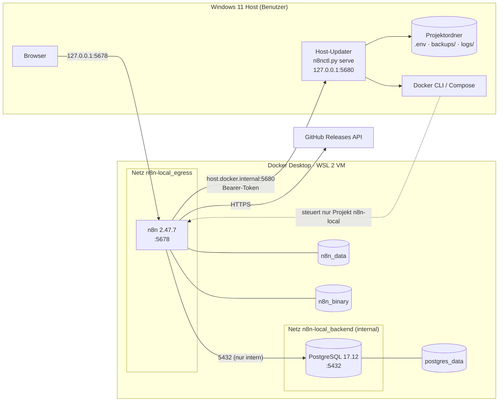
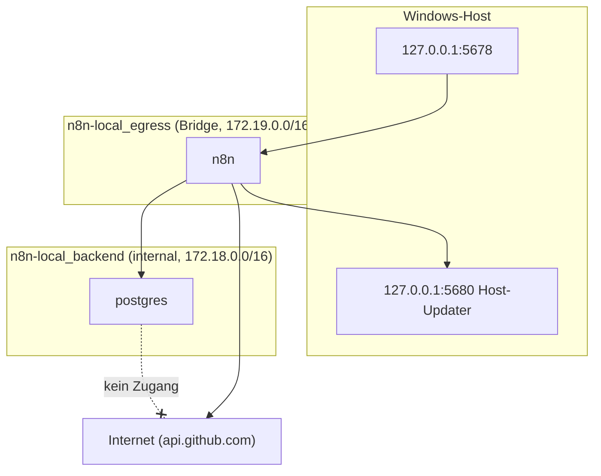
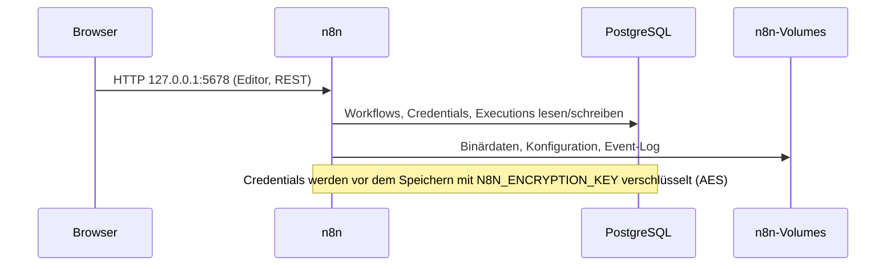
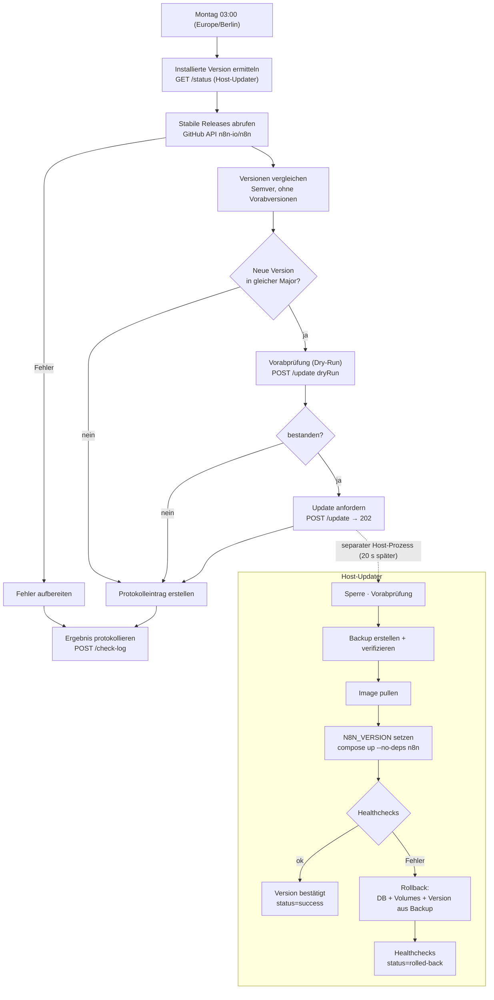
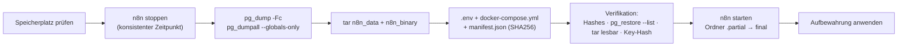

# Architektur: n8n-local

Dieses Dokument beschreibt den technischen Aufbau der lokalen n8n-Umgebung, die Datenflüsse, den abgesicherten Host-Updater, das Backup-/Rollback-Konzept und das Sicherheitsmodell.

| Dokument | Inhalt |
| --- | --- |
| [Installationsanleitung](installation-guide.md) | Neuinstallation Schritt für Schritt |
| **Architektur** (dieses Dokument) | Aufbau, Netzwerke, Volumes, Updater, Sicherheitskonzept |
| [Wartung und Administration](maintenance.md) | Betrieb, Backup, Restore, Updates, Fehleranalyse |

## Systemübersicht

Die Umgebung besteht aus drei Laufzeitbausteinen auf einem Windows-11-Rechner:

1. **Docker Desktop (WSL 2)** mit dem Compose-Projekt `n8n-local`: Container `n8n` und `postgres` sowie der Einmal-Container `n8n-volume-init`.
2. **Host-Updater** `updater/n8nctl.py`: ein Python-Prozess im Benutzerkontext, gestartet von der Windows-Aufgabenplanung, der nur auf `127.0.0.1:5680` lauscht.
3. **Dateisystem des Projekts**: `.env` (Geheimnisse), `backups/`, `logs/`, `updater/state/`.

## Docker-Container-Architektur

| Container | Image | Rolle | Benutzer | Neustart |
| --- | --- | --- | --- | --- |
| `postgres` | `postgres:17.12` | primäre Datenbank von n8n | `postgres` (im Image) | `unless-stopped` |
| `n8n` | `docker.n8n.io/n8nio/n8n:2.47.7` | Workflow-Plattform, Editor, Scheduler, interner JS-Task-Runner | `node` (UID 1000) | `unless-stopped` |
| `n8n-volume-init` | `alpine:3.22` | setzt einmalig den Besitzer des Binary-Volumes, beendet sich danach | `root`, ohne Netzwerk | `no` |

Startreihenfolge über `depends_on`: `postgres` (healthy) und `volume-init` (erfolgreich beendet) → `n8n`.

Healthchecks:

| Container | Test | Intervall / Wiederholungen / Startphase |
| --- | --- | --- |
| `postgres` | `pg_isready -U n8n -d n8n -h 127.0.0.1` | 10 s / 10 / 20 s |
| `n8n` | `GET http://127.0.0.1:5678/healthz/readiness` (prüft DB und Migrationen) | 30 s / 5 / 90 s |

## Kommunikation zwischen n8n und PostgreSQL

- n8n verbindet sich über den Service-Namen `postgres` auf Port `5432` (`DB_TYPE=postgresdb`).
- Die Verbindung läuft ausschließlich über das Netz `n8n-local_backend`. Es ist mit `internal: true` angelegt: Es hat kein Gateway nach außen, und an ihm wird kein Port veröffentlicht.
- PostgreSQL ist nur an dieses Netz angeschlossen. Es kann weder ins Internet noch wird es auf dem Host veröffentlicht.
- Zugangsdaten kommen aus `.env` und werden beiden Containern als Umgebungsvariablen übergeben.

## Netzwerkstruktur

| Netz | Typ | Mitglieder | Zweck |
| --- | --- | --- | --- |
| `n8n-local_backend` | Bridge, `internal: true` | n8n, postgres | Datenbankverkehr, isoliert |
| `n8n-local_egress` | Bridge | n8n | ausgehend (GitHub-API, Workflows), Port-Veröffentlichung, Host-Updater |

| Port | Bindung | Dienst |
| --- | --- | --- |
| 5678 | `127.0.0.1` auf dem Host | n8n Editor/API/Webhooks |
| 5680 | `127.0.0.1` auf dem Host | Host-Updater (Python) |
| 5432 | nur `n8n-local_backend` | PostgreSQL |
| 5679 | nur im n8n-Container (Loopback) | interner Task-Broker von n8n |

`host.docker.internal` wird von Docker Desktop auf den Loopback des Hosts weitergeleitet. Dadurch erreicht der n8n-Container den Updater, obwohl dieser nur an `127.0.0.1` gebunden und aus dem LAN nicht erreichbar ist (getestet).

## Persistente Volumes

| Volume | Container-Pfad | Inhalt | Backup als |
| --- | --- | --- | --- |
| `n8n-local_postgres_data` | `/var/lib/postgresql/data` | Workflows, Credentials (verschlüsselt), Ausführungen, Benutzer, Einstellungen | `database.dump` (pg_dump, Custom-Format) + `globals.sql` |
| `n8n-local_n8n_data` | `/home/node/.n8n` | Instanz-Konfiguration, Event-Logs, installierte Nodes | `n8n-data.tar.gz` |
| `n8n-local_n8n_binary` | `/home/node/.n8n/binaryData` | Binärdaten (`N8N_DEFAULT_BINARY_DATA_MODE=filesystem`) | `n8n-binary.tar.gz` |

Eigenschaften:

1. Container-Neustart, `docker compose down`, Image-Update und Rechner-Neustart lassen die Volumes unverändert. Das wurde getestet.
2. Die Datenbank liegt in einem eigenen Volume, unabhängig vom n8n-Container.
3. Gelöscht werden Volumes nur explizit mit `docker compose down -v` oder `docker volume rm`.

## Datenfluss

Credentials liegen ausschließlich verschlüsselt in der Tabelle `credentials_entity`. Getestet wurde, dass kein Klartext in der Datenbank steht und die Entschlüsselung nach Neustart, Restore und Update funktioniert.

## Host-Updater-Architektur

Der Host-Updater ist der einzige Baustein, der Docker steuert. n8n selbst hat **keinen** Zugriff auf den Docker-Socket.

| Eigenschaft | Umsetzung |
| --- | --- |
| Laufzeit | Python 3, nur Standardbibliothek, `pythonw.exe` (kein Fenster) |
| Start | Windows-Aufgabe „n8n-local Host-Updater“, bei Anmeldung, Neustart bei Absturz |
| Bindung | nur `127.0.0.1:5680` (`UPDATER_HOST` außer Loopback wird abgelehnt) |
| Authentifizierung | `Authorization: Bearer <UPDATER_TOKEN>`, 256 Bit, zeitkonstanter Vergleich (`hmac.compare_digest`), 1 s Verzögerung bei Fehlversuch |
| Endpunkte | `GET /health` (ohne Auth), `GET /status`, `GET /check`, `POST /update`, `POST /check-log`; sonst 404 |
| Eingabevalidierung | max. 4 KB, nur `application/json`, nur erlaubte Felder, Version per Regex `^\d+\.\d+\.\d+$` |
| Erlaubte Operationen | fest codierte `docker`-/`docker compose`-Aufrufe als Argumentliste, keine Shell, nur Projekt `n8n-local` |
| Parallelität | exklusive Sperrdatei `updater/state/update.lock` (O_EXCL), HTTP 409 bei laufendem Update |
| Entkopplung | Update läuft als **separater Host-Prozess**, startet 20 s nach der Antwort `202 Accepted` |
| Protokoll | `logs/updates.jsonl`, `logs/version-checks.jsonl`, `logs/updater.log` (Host-Dateisystem) |

### Endpunkt `POST /update`

| Feld | Typ | Pflicht | Bedeutung |
| --- | --- | --- | --- |
| `version` | String `x.y.z` | ja | Zielversion |
| `dryRun` | Boolean | nein | nur Vorabprüfung, keine Änderung |
| `requestedBy` | String ≤ 64 | nein | Absender (Protokoll) |
| `executionId` | String ≤ 32 | nein | n8n-Ausführungs-ID (Protokoll) |

Antworten: `200` (Dry-Run-Ergebnis), `202` (angenommen), `400` (ungültige Eingabe), `401` (Token), `409` (Update läuft), `422` (Vorabprüfung nicht bestanden).

### Vorabprüfung (Kompatibilität)

| Prüfung | Bedingung |
| --- | --- |
| `newer` | Zielversion > installierte Version (Semantic Versioning) |
| `sameMajor` | gleiche Major-Version, Major-Sprünge nur manuell |
| `officialStableRelease` | GitHub-Release `n8n@x.y.z` existiert, kein Draft/Prerelease |
| `noBreakingChangeNotice` | Release Notes enthalten nicht „breaking change“ |
| `imageAvailable` | `docker manifest inspect docker.n8n.io/n8nio/n8n:x.y.z` erfolgreich |
| `diskSpace` | frei ≥ 2 × Volumegröße + `MIN_FREE_GB` + 2 GB für das Image |
| `noUpdateRunning` | keine aktive Sperre |
| `currentInstallationHealthy` | alle Healthchecks der laufenden Installation grün |

## Automatisierter Update-Prozess

Workflow **„Weekly n8n Version Checker & Auto Updater“** (ID `weeklyN8nUpdater`), Schedule-Trigger **montags 03:00, Zeitzone `Europe/Berlin`**.

Entscheidungen des Knotens „Versionen vergleichen“:

| `decision` | Bedingung | Aktion |
| --- | --- | --- |
| `none` | installiert = neueste stabile Version | nur protokollieren |
| `update` | neuere stabile Version in gleicher Major | Dry-Run, dann Update anfordern |
| `manual` | neue Major-Version oder „breaking change“ in den Release Notes | protokollieren, kein Auto-Update |
| `skip` | Updater meldet laufendes Update | protokollieren |
| `blocked` | konfigurierte ≠ laufende Version oder Vorabprüfung nicht bestanden | protokollieren |
| `error` | GitHub-/Updater-Fehler | Fehler protokollieren |

Versionsquelle: `https://api.github.com/repos/n8n-io/n8n/releases?per_page=100`. Berücksichtigt werden nur Tags der Form `n8n@x.y.z` mit `prerelease=false` und `draft=false`. Das schließt Beta-, RC- und Kanal-Tags wie `stable` oder `beta` aus. Parallel gepflegte Wartungslinien (z. B. `1.123.x`) werden korrekt per Semver einsortiert.

Ein Update gilt erst als erfolgreich, wenn **alle** Healthchecks grün sind:

| Check | Kriterium |
| --- | --- |
| `postgres_container` | läuft und ist `healthy` |
| `n8n_container` | läuft und ist `healthy` |
| `n8n_version` | `n8n --version` im Container = Zielversion |
| `database_schema` | Tabelle `migrations` lesbar, > 0 Einträge |
| `n8n_readiness` | `GET 127.0.0.1:5678/healthz/readiness` = 200 |
| `web_ui` | `GET 127.0.0.1:5678/` = 200 mit HTML |

## Backup- und Rollback-Architektur

Backup-Ordner `backups/JJJJMMTT-HHMMSS-<grund>/`:

| Datei | Inhalt |
| --- | --- |
| `database.dump` | PostgreSQL-Dump (Custom-Format, komprimiert) |
| `globals.sql` | Rollen/Globals |
| `n8n-data.tar.gz` | Volume `n8n_data` |
| `n8n-binary.tar.gz` | Volume `n8n_binary` |
| `env.backup` | `.env` inkl. `N8N_ENCRYPTION_KEY` |
| `docker-compose.yml` | Compose-Datei zum Zeitpunkt des Backups |
| `manifest.json` | Zeitpunkt, Grund, n8n-/PostgreSQL-Version, Images, SHA-256 aller Dateien, SHA-256 des Encryption Keys |

Konsistenzregeln:

- Datenbank, Volumes und Encryption Key stammen aus **demselben** Zeitpunkt, weil n8n während des Backups gestoppt ist.
- Ein Backup gilt erst nach erfolgreicher Verifikation als gültig (`.partial` wird umbenannt). Schlägt sie fehl, wird es gelöscht, und ein anstehendes Update startet nicht.
- **Rollback = vollständiger Restore** des Pre-Update-Backups: alte `N8N_VERSION`, Datenbank (drop/create + `pg_restore`) und beide n8n-Volumes. Nur das Image zurückzusetzen reicht nicht, weil die neue Version bereits Migrationen ausgeführt haben kann, die das alte Image nicht versteht.
- Ein Restore prüft vorher, ob der Encryption Key der aktuellen `.env` zum Backup passt, und bricht sonst ab. Mit `-RestoreEnv` wird die `.env` aus dem Backup übernommen. Bei einem manuellen Restore entsteht vorher automatisch ein Sicherheits-Backup `pre-restore`.
- Aufbewahrung: Backups älter als `BACKUP_RETENTION_DAYS` (30) werden gelöscht, die `BACKUP_KEEP_MIN` (5) neuesten bleiben immer erhalten.

## Sicherheitskonzept

| Bedrohung / Anforderung | Maßnahme |
| --- | --- |
| Zugriff aus LAN/Internet | n8n nur an `127.0.0.1:5678`, Updater nur an `127.0.0.1:5680`, PostgreSQL ohne Host-Port |
| Datenbank-Exfiltration ins Internet | PostgreSQL nur im `internal`-Netz |
| Container-Ausbruch über Docker-Socket | kein Socket-Mount in n8n, Docker-Steuerung nur durch den Host-Updater |
| Missbrauch der Updater-API | Bearer-Token (256 Bit), nur fest definierte Operationen, strikte Validierung, Sperre gegen Parallelität |
| Beliebige Befehle | keine Shell; `docker`-Aufrufe nur als Argumentliste, Version nur `x.y.z` |
| Rechteausweitung | `no-new-privileges:true`, n8n läuft als `node` (UID 1000), keine `privileged`-Container |
| Geheimnisse in Git | `.env`, `backups/`, `logs/` in `.gitignore`; der Workflow-Export enthält nur die Credential-Referenz |
| Verlust des Encryption Key | Key in `.env` und in jedem Backup; Key-Hash im Manifest; Restore prüft Übereinstimmung |
| Ungeprüfte Community-Pakete | `N8N_UNVERIFIED_PACKAGES_ENABLED=false` |
| Telemetrie | `N8N_DIAGNOSTICS_ENABLED=false` |
| Unkontrollierte Versionen | gepinnte Images; Updates nur stabil, gleiche Major, mit Backup und Rollback |

> **Warnung:** Backups enthalten den Encryption Key und alle Daten im Klartext-Dump. Sie dürfen den Rechner nur verschlüsselt verlassen (z. B. 7-Zip AES-256 oder BitLocker-To-Go).

> **Hinweis:** `N8N_SECURE_COOKIE=false` ist nur für den Betrieb über HTTP auf `localhost` vertretbar. Wer n8n je im Netz veröffentlicht, braucht HTTPS über einen Reverse-Proxy und muss diesen Wert wieder auf `true` setzen.

## Technische Entscheidungen

| Entscheidung | Begründung |
| --- | --- |
| Host-Updater in Python statt PowerShell-HTTP-Listener | `HttpListener` braucht URL-ACLs/Adminrechte und prüft den Host-Header. Pythons `http.server` bindet direkt an 127.0.0.1, und `subprocess` mit Argumentlisten verhindert Shell-Injection. |
| Geplante Aufgabe statt Windows-Dienst | Docker Desktop läuft im Benutzerkontext, ein Dienst (SYSTEM) hätte keinen Zugriff auf dessen Engine. Außerdem sind keine Adminrechte nötig. |
| PostgreSQL 17 statt 18 | ausgereift, Support bis 2029; vermeidet die mit 18 geänderte PGDATA-Struktur des Images |
| Interner Task-Runner | ausreichend für lokale Nutzung; ein externer Runner-Container ist optional und in den Docs von n8n beschrieben |
| Auto-Update nur innerhalb der Major-Version | Major-Versionen können Breaking Changes enthalten, die eine manuelle Prüfung erfordern |
| Update in separatem Prozess, 20 s verzögert | Die n8n-Ausführung kann die HTTP-Antwort und ihr Protokoll abschließen, bevor n8n neu startet. |

## Referenzen

- n8n Docker-Installation: <https://docs.n8n.io/hosting/installation/docker/>
- n8n Datenbank-Umgebungsvariablen: <https://docs.n8n.io/hosting/configuration/environment-variables/database/>
- n8n CLI-Befehle: <https://docs.n8n.io/hosting/cli-commands/>
- n8n Releases: <https://github.com/n8n-io/n8n/releases>
- PostgreSQL Docker-Image: <https://hub.docker.com/_/postgres>
- pg_dump: <https://www.postgresql.org/docs/17/app-pgdump.html>
- Docker Desktop für Windows: <https://docs.docker.com/desktop/setup/install/windows-install/>
