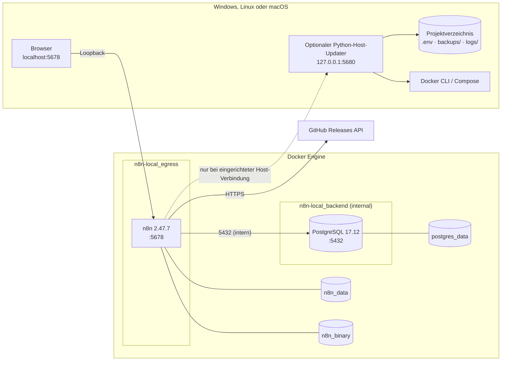
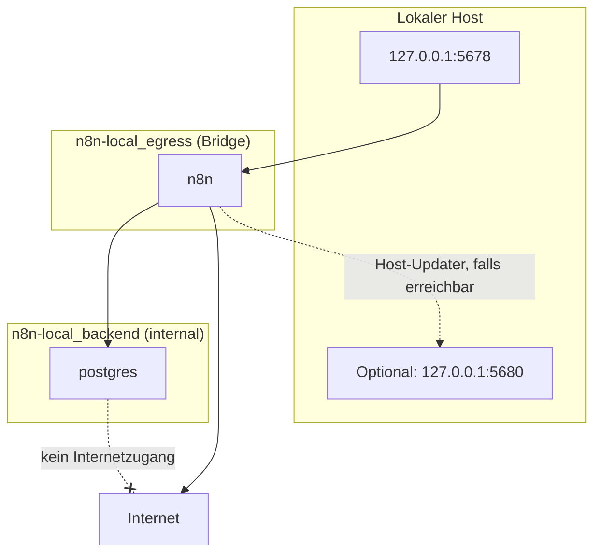
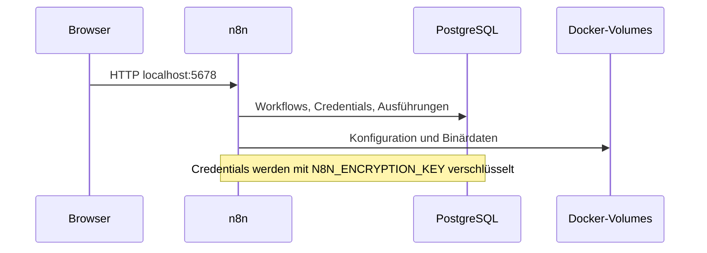

# Architektur: n8n lokal mit Docker Compose

Die Umgebung besteht aus Docker-Containern, benannten persistenten Volumes und optionalen Python-Werkzeugen auf dem Host. Compose und n8n/PostgreSQL sind auf Windows (Docker Desktop), Linux (Docker Engine) und macOS (Docker Desktop) nutzbar. Die Host-Integration des optionalen automatisierten Updaters unterscheidet sich nach Betriebssystem; siehe [Host-Updater](#host-updater).

| Dokument | Inhalt |
| --- | --- |
| [Installation](installation-guide.md) | Docker-Installation und Inbetriebnahme |
| **Architektur** (dieses Dokument) | Container, Daten, Netzwerke und Sicherheit |
| [Wartung](maintenance.md) | Backup, Restore und Updates |

## Systemübersicht

## Container und Startreihenfolge

| Service | Image | Aufgabe |
| --- | --- | --- |
| `postgres` | `postgres:17.12` | persistente n8n-Datenbank |
| `volume-init` | `alpine:3.22` | setzt einmalig Besitzerrechte des Binary-Volumes |
| `n8n` | `docker.n8n.io/n8nio/n8n:2.47.7` | Editor, API, Workflows und Scheduler |

Compose startet n8n erst, wenn PostgreSQL gesund und `volume-init` erfolgreich abgeschlossen ist. Die Image-Versionen sind in `.env` gepinnt; `latest` wird nicht verwendet. Healthchecks prüfen PostgreSQL mit `pg_isready` und n8n mit `/healthz/readiness`.

## Netzwerke und Ports

| Port | Erreichbarkeit | Zweck |
| --- | --- | --- |
| 5678 | Host-Loopback (`127.0.0.1`) | n8n Editor, API und Webhooks |
| 5680 | Host-Loopback, wenn Updater gestartet | optionale Updater-API |
| 5432 | nur internes Compose-Netz | PostgreSQL |

`backend` ist `internal: true` und verbindet nur n8n mit PostgreSQL. n8n hängt zusätzlich an `egress`, damit es externe APIs erreichen kann. PostgreSQL hat keinen Host-Port. Der n8n-Host-Port wird nicht im LAN veröffentlicht.

## Persistente Daten

| Volume | Container-Pfad | Inhalt |
| --- | --- | --- |
| `n8n-local_postgres_data` | `/var/lib/postgresql/data` | Workflows, Benutzer, Ausführungen und verschlüsselte Credentials |
| `n8n-local_n8n_data` | `/home/node/.n8n` | Instanzkonfiguration und installierte Nodes |
| `n8n-local_n8n_binary` | `/home/node/.n8n/binaryData` | Binärdaten der Ausführungen |

Die Volume-Pfade sind **Pfade innerhalb der Linux-Container**, keine Verzeichnisse, die auf dem Host angelegt werden müssen. Die tatsächliche Speicherverwaltung übernimmt Docker. `docker compose down` entfernt die Container, nicht aber die benannten Volumes. `docker compose down -v` löscht diese Daten.

## Datenfluss und Geheimnisse

`.env` enthält unter anderem Datenbankpasswort, `N8N_ENCRYPTION_KEY` und Updater-Token. Sie wird beim ersten Start gelesen und darf nicht verloren gehen. Backups enthalten eine Kopie dieser Datei sowie alle Instanzdaten. Backups daher nur verschlüsselt außerhalb des Rechners speichern. `.env`, `backups/` und `logs/` sind in `.gitignore` ausgeschlossen.

## Host-Updater

`updater/n8nctl.py` verwendet die Python-Standardbibliothek und Docker CLI. Direkte Verwaltungsbefehle wie `health`, `backup`, `restore`, `check` und `update` laufen auf Windows, Linux und macOS. n8n selbst erhält keinen Docker-Socket.

Die optionale HTTP-API bindet standardmäßig ausschließlich an `127.0.0.1:5680` und authentifiziert schreibende bzw. statusbezogene Aufrufe mit `Authorization: Bearer <UPDATER_TOKEN>`. Die Windows-Task-Scheduler-Integration ist in `scripts/install-updater-task.ps1` enthalten. Auf macOS kann `python3 updater/n8nctl.py serve` in einer angemeldeten Sitzung gestartet werden (Windows PowerShell: `py -3 updater\n8nctl.py serve`).

Docker Desktop bietet unter Windows/macOS `host.docker.internal`; die Erreichbarkeit einer Host-Anwendung hängt jedoch von Docker-Desktop-Version und Host-Firewall ab. Bei nativem Linux-Docker kann ein Container den auf Loopback gebundenen Host-Updater standardmäßig nicht erreichen. Der Updater wird absichtlich nicht auf `0.0.0.0` geöffnet. Aktivieren Sie den Workflow unter Linux erst nach einer separaten, auf Docker-Host und Firewall beschränkten Netzwerkkonfiguration. Ohne diese Verbindung sind manuelle Updates und Backups weiterhin verfügbar.

## Backup, Restore und Rollback

`python3 updater/n8nctl.py backup` erstellt ein konsistentes Backup aus Datenbank, n8n-Volumes, `.env`, Compose-Datei und SHA-256-Manifest. Das Backup wird vor Abschluss geprüft. Ein Restore ersetzt Datenbank und Volumes gemeinsam; das ist auch die Voraussetzung für einen sicheren Rollback nach einem n8n-Update, das Datenbankmigrationen ausgeführt hat. Unter Windows PowerShell lautet der Python-Befehl `py -3 updater\n8nctl.py backup`. Details stehen in [Wartung](maintenance.md).

## Sicherheitsmaßnahmen

- n8n wird nur an `127.0.0.1` veröffentlicht; PostgreSQL erhält keinen Host-Port.
- PostgreSQL liegt ausschließlich im internen Compose-Netz.
- Kein Docker-Socket wird in n8n gemountet.
- Container verwenden `no-new-privileges`; Images und Ressourcen sind begrenzt.
- n8n-Telemetrie und ungeprüfte Community-Pakete sind deaktiviert.
- Zugangsdaten und Backup-Dateien werden nicht in Git eingecheckt.
- `N8N_SECURE_COOKIE=false` ist nur für lokale HTTP-Nutzung vorgesehen. Eine externe Veröffentlichung erfordert HTTPS und eine gesonderte Konfiguration.

## Referenzen

- [Docker Engine installation](https://docs.docker.com/engine/install/)
- [Docker Desktop für Windows](https://docs.docker.com/desktop/setup/install/windows-install/)
- [Docker Desktop für macOS](https://docs.docker.com/desktop/setup/install/mac-install/)
- [Docker Compose](https://docs.docker.com/compose/)
- [n8n Docker-Installation](https://docs.n8n.io/hosting/installation/docker/)
- [PostgreSQL Docker-Image](https://hub.docker.com/_/postgres)
